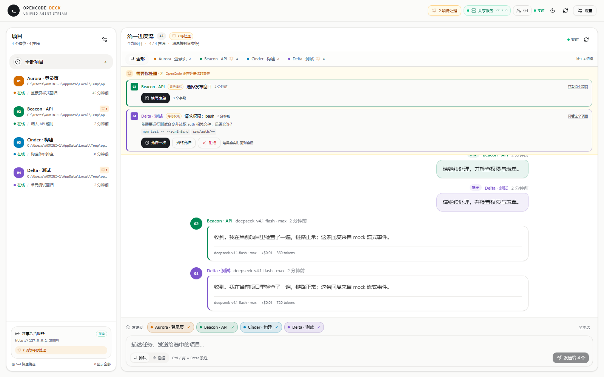

# OpenCode Deck

[](LICENSE)

[简体中文](README.md) | **English**

Monitor up to **four OpenCode v2 projects** from one local web page. Progress from all projects is interleaved into a single activity stream, each project with a fixed color. Filter to one project, or send an instruction to 1–4 projects at once. Permission requests and forms surface prominently at the top and can be handled without going back to the TUI.

> Tested on Windows 11 with OpenCode **v2.2.6**. Real `deepseek-v4.1-flash` replies and SSE streaming were verified; the permission/form flow was verified with a local mock.
>
> GitHub: [hiwow/opencode-deck](https://github.com/hiwow/opencode-deck)



> Preview uses mock data; it only illustrates the UI structure.

---

## Features

- **One unified activity stream**: user instructions, assistant replies, and tool calls from four projects are interleaved chronologically, so you can see everything on one screen.
- **Auto-load running OpenCode windows**: on startup, Deck detects running `opencode` TUIs and fills empty slots automatically. It can be disabled in Settings, or triggered manually at any time.
- **Fixed project colors**: each slot has its own color (amber / emerald / sky / violet) used by the sidebar, filter chips, messages, and composer targets.
- **Fast session filtering**: click the sidebar, the colored filter bar, or the mobile project strip to focus one project. Press `1–4` to switch, `0` / `Esc` to show all.
- **Single-project sending by default**: selecting a project also selects its recipient. Returning to All keeps the last recipient and never enables broadcast automatically. For occasional broadcasts, write an instruction, open **More → Send to multiple projects**, then select and confirm recipients. Queue and steer remain available.
- **Session follow / pin**: when focused on one project, switch between its sessions, create a new session, or toggle follow-latest next to the chat title.
- **Prominent interaction alerts**: when OpenCode asks for permission or creates a form, an amber pending bar appears at the top and counts are shown in the top bar and sidebar:
  - Permission: allow once / always allow / reject;
  - Form: fields are rendered by type and submitted directly from the page.
- **Light and dark themes**: light is the default; toggle dark in the top-right corner. The choice is persisted.
- **Realtime + fallback**: subscribes to OpenCode's `/api/event` stream with automatic reconnects; when SSE is unavailable, an 8-second polling fallback keeps content in sync.
- **Full content rendering**: Markdown, copyable code blocks, tables, collapsible tool calls, reasoning, errors, tokens, and cost.

## Tech stack

| Layer | Choice |
| --- | --- |
| Frontend | **React 19 + TypeScript + Vite 6** |
| UI | **shadcn/ui (new-york) + Tailwind CSS 4**, Radix primitives, lucide icons |
| Notifications | sonner |
| Markdown | marked + DOMPurify |
| Backend | Node.js 22 native `http` + `fetch`, no Express |
| Realtime | OpenCode SSE → backend → browser SSE |
| Configuration | local `config.json` |
| Launcher | `npm start` / `start.cmd` |

`components.json` follows the shadcn convention, and `src/components/ui/*` contains local component source. There are no runtime CDN dependencies.

## Quick start

Requirements: Node.js **22+**, OpenCode v2 installed and signed in at least once.

```powershell
git clone https://github.com/hiwow/opencode-deck.git
cd opencode-deck
npm install
npm start
```

Open <http://127.0.0.1:5178>.

On first launch, Deck looks for running OpenCode TUIs:

1. If one is found, its project is filled into an empty slot and connected automatically; manual setup is usually unnecessary.
2. If none is found, the settings dialog opens:
   - click **Auto-load** to detect again;
   - or click **Fill recent projects**;
   - or choose up to four project directories manually.
3. Click **Save and connect**.
4. If the shared service is not running, click **Start shared service**, or run:
   ```powershell
   opencode service start
   ```

> You can also double-click `start.cmd`: it installs dependencies, builds, and opens the browser.

### Auto-load rules

- Deck looks for TUI processes named `opencode*`; subcommands such as `serve`, `service`, and `run` are excluded.
- If the command line contains a project directory, that directory is preferred.
- Otherwise Deck uses the most recently active projects from the shared service's `/api/project`, mapping at most one project per TUI and filling at most four slots.
- Only empty slots are filled; configured projects are never overwritten. Auto-load runs on every startup by default and can be disabled with **"Auto-load OpenCode windows on startup"** in Settings.
- A TUI started with `--standalone` is still recognized, but its private server has no public port. Deck can only poll shared session data, so realtime behavior is weaker than the default shared mode.
- A TUI started with `--server` against a remote/private instance cannot reveal its URL or password automatically; configure it manually.

> On Windows, process details come from PowerShell `Get-CimInstance`. If policy blocks reading process command lines, auto-load falls back to manual setup.

### Development mode

```powershell
npm run dev
```

- Frontend Vite + HMR: <http://127.0.0.1:5173>
- Backend API: <http://127.0.0.1:5178>
- `/api` is proxied by Vite.

```powershell
npm run typecheck   # TypeScript check
npm run build       # build frontend
npm run serve       # backend only (build first)
```

> If `NODE_ENV=production` is set, `npm install` skips devDependencies; run `npm install --include=dev` before typechecking. `npm start` only needs the Vite/tsx dependencies.

## Interface

### Unified activity stream

- Left sidebar: connection state, current session, last activity, running progress, unread state, and pending count for all four projects.
- Center: messages from every project are interleaved chronologically. Each project has a fixed color:
  - user instructions are right-aligned with a light project-tinted bubble;
  - assistant replies are left-aligned with a 3px project-colored left border;
  - a running turn shows LIVE and a stop button;
  - tool calls and reasoning are collapsed below the reply.
- Colored filter bar: `All` plus the four projects. When a project is focused, a **session switcher** appears next to the chat title.
- Composer: shows the current recipient with a project selector. Sending is disabled until a project is chosen. Type, select queue/steer, and send; multi-project sending is under More and requires recipient confirmation.

### Keyboard

| Shortcut | Action |
| --- | --- |
| `1` – `4` | Focus the corresponding slot; press again to return to all |
| `0` / `Esc` | Show all projects |
| `Ctrl / ⌘ + Enter` | Send the composer contents |

### Interaction alerts

When OpenCode needs a decision:

1. An amber **Needs your input** bar appears at the top, with the project color and type (waiting for permission / waiting for input).
2. The top bar shows `N pending`; the corresponding project in the sidebar gets a bell count.
3. Permission requests can be handled directly in the pending bar with **Allow once / Always allow / Reject**.
4. For forms, click **Fill form** to open a dialog; submitting sends the answer back to the session immediately.

Supported form fields: `string` (including options), `number`, `integer`, `boolean`, `multiselect`, and `external` (link). `when` conditions are not evaluated yet, so all fields are shown.

## Connection modes

| Mode | Behavior | Good for |
| --- | --- | --- |
| **Shared service** (default) | Reads `~/.local/state/opencode/service.json` and connects to the background service used by the TUI | Seeing replies from four TUI windows in realtime |
| **Dedicated service** | Starts an `opencode serve` in the project directory, allocates a port in 4100–4199, and manages the password | Giving a project its own event stream/port |
| **Manual URL** | Connects to an existing `http://host:port` with Basic Auth | Already-running or remote services |

All three modes can be used at the same time.

### Shared vs dedicated realtime

OpenCode v2 stores session data globally, but the **SSE event bus belongs to a specific server instance**:

- **Shared mode**: the page connects to the same background service as the TUI, so TUI replies stream in realtime.
- **Dedicated mode**: the dedicated `opencode serve` only publishes its own events to the page. Sessions from a TUI connected to another instance are synced through the 8-second polling fallback, not token-by-token.
- **Manual mode**: depends on the instance; polling fallback still applies.

## How it works

```text
Browser (React + shadcn/Tailwind)
   │  SSE /api/stream + REST
   ▼
Node HTTP server (127.0.0.1:5178)
   │  Basic Auth proxy / event normalization / interaction state
   ├── shared background service  http://127.0.0.1:28894  (discovered from service.json)
   ├── dedicated service          http://127.0.0.1:4100+  (spawned on demand)
   └── manual service             http://host:port
```

- One OpenCode SSE connection is created per unique server URL and routed to slots by `location.directory` / `sessionID`.
- Permissions and forms use both events and `GET /permission` / `GET /form` snapshots, so pending items survive a refresh or backend restart.
- The browser only receives a `hasPassword` flag; passwords never leave the backend.

## Configuration

Saving creates `config.json` in the project root:

```json
{
  "port": 5178,
  "autoLoad": true,
  "agents": [
    {
      "id": "slot-1",
      "label": "My app",
      "directory": "D:\\projects\\my-app",
      "mode": "shared",
      "follow": true
    }
  ]
}
```

| Field | Meaning |
| --- | --- |
| `autoLoad` | Detect OpenCode TUIs on startup and fill empty slots; defaults to `true` |
| `label` | Display name; falls back to the directory name |
| `directory` | Absolute project path |
| `mode` | `shared` / `dedicated` / `manual` |
| `follow` | Follow the latest session |
| `serverUrl` | Server URL for manual mode |
| `password` | Password for manual mode |
| `sessionId` | Pin a specific session |
| `dedicatedPort` / `dedicatedPassword` | Written automatically by dedicated mode; no need to edit |

Environment variables:

| Variable | Purpose |
| --- | --- |
| `PORT` | Backend port (default 5178) |
| `OPENCODE_DECK_CONFIG` | Custom config file path |
| `OPENCODE_SERVICE_FILE` | Custom `service.json` path |
| `OPENCODE_BIN` | Custom `opencode` executable |

> Dedicated services are managed as child processes and are stopped on shutdown. A forced backend termination may leave an orphan `opencode serve`; on restart Deck tries to reuse an instance on the same port with the matching password. Use `Get-NetTCPConnection -LocalPort 4100` to find and stop an orphan.

## HTTP API

| Method | Path | Description |
| --- | --- | --- |
| GET | `/api/bootstrap` | Config, service, slots, projects, pending interactions |
| GET | `/api/stream` | Browser SSE (snapshot / agent / messages / notice) |
| POST | `/api/config` | Save four slots and the `autoLoad` flag |
| POST | `/api/discover` | Rediscover the shared service |
| POST | `/api/auto-load` | Detect running TUIs and fill empty slots |
| POST | `/api/service/start` / `/stop` | Start/stop the shared service |
| GET | `/api/projects` | Recent projects (existing dirs, no `global`, deduplicated) |
| GET | `/api/agents/:id/sessions` | Root sessions for a project |
| POST | `/api/agents/:id/session` | `{sessionId}` to switch / `{create:true}` to create |
| POST | `/api/agents/:id/prompt` | `{text, delivery}` |
| POST | `/api/agents/:id/interrupt` | Interrupt the current run |
| POST | `/api/agents/:id/sync` | Sync now |
| POST | `/api/agents/:id/seen` | Clear unread state |
| POST | `/api/agents/:id/follow` | `{follow}` |
| POST | `/api/agents/:id/permission/:requestId` | `{decision: once\|always\|reject, message?}` |
| POST | `/api/agents/:id/form/:formId` | `{answer: Record<string, unknown>}` |
| POST | `/api/send` | `{targets, text, delivery}` batch send |

## Troubleshooting

**Shared service offline**

```powershell
opencode service status
opencode service start
```

Check that `~/.local/state/opencode/service.json` exists, then click **Rediscover** in Settings.

**Free model quota exhausted**

The page uses the session's current model; a new session uses OpenCode's default model. If the default is a free model with no quota left, switch to an available model such as `deepseek-v4.1-flash` in the TUI with `/model`, then send the instruction again.

**Dedicated service will not start**

- The project directory must exist.
- If ports 4100–4199 are occupied, another port is chosen automatically.
- `OPENCODE_BIN` can point to a specific binary.
- Dedicated and shared services use the same store but have separate event streams; this is expected.

**Port 5178 is in use**

```powershell
$env:PORT=5180
npm start
```

The Vite dev proxy is fixed to 5178; update `vite.config.ts` as well if you change it in development.

**Sessions or projects are missing**

The project list only includes directories that still exist, hides OpenCode's `global` project, and removes duplicates. Enter an existing absolute path manually to add a project.

## Security

- The backend listens on `127.0.0.1` only and has no login layer; do not expose the port to a LAN or the internet.
- `config.json` stores manual/dedicated service passwords in plaintext and is ignored by `.gitignore`.
- The browser never receives passwords.
- Markdown is sanitized with `marked` + `DOMPurify`.

## Known limitations

- Four fixed slots.
- Auto-load depends on process command lines; TUIs started with `--server` cannot reveal their remote URL/password automatically.
- `--standalone` TUIs are loaded, but only shared session data is polled; there is no private realtime stream.
- Auto-load fills empty slots only and never overwrites configured projects. It can be disabled entirely in Settings.
- Interactions cover permissions and forms; attachments and file pickers are not built in yet.
- Form `when` conditions are not evaluated; all fields are shown.
- A crashed dedicated service is not restarted indefinitely; saving/switching slots or restarting Deck starts it again.
- The OpenCode v2 HTTP API is still marked Experimental and may change; this project targets 2.2.6.
- Monitoring history is not persisted; history comes from OpenCode sessions.

## Project layout

```text
server/                 Node backend (config, discovery, OpenCode client, Hub, HTTP)
server/processes.ts     opencode TUI process detection and directory parsing
src/App.tsx             unified stream shell
src/components/         TopBar / ProjectSidebar / UnifiedChat / Composer
src/components/         InteractionAlerts / ChatMessage / ToolList / Markdown
src/components/ui/      local shadcn components (button/dialog/select/...)
shared/types.ts         shared frontend/backend types
docs/preview.png        UI preview
config.example.json
start.cmd
vite.config.ts
```

## License

MIT © 2026 [hiwow](https://github.com/hiwow). See [LICENSE](LICENSE).
