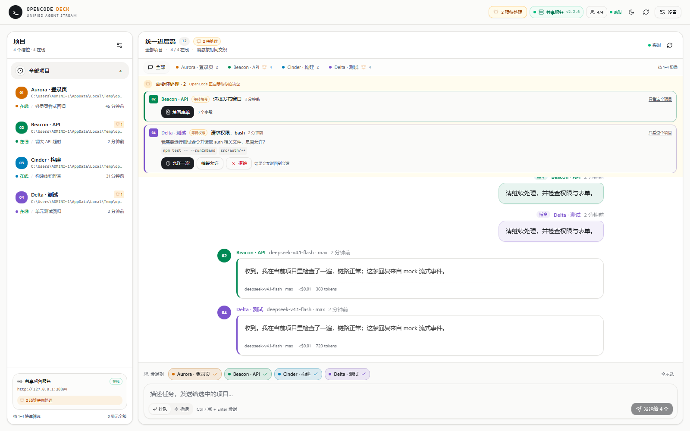

# OpenCode Deck

在同一个本地 Web 页面里监控最多 **4 个 OpenCode v2 项目**。四个项目的进度汇入一个统一对话流，各自有固定颜色；可以按项目快速筛选，也可以一次向 1–4 个项目下达指令。遇到权限请求或需要填写表单时，会在顶部显著提醒并可直接处理。

> 已在 Windows 11 + OpenCode **v2.2.6** 上验证；真实 `deepseek-v4.1-flash` 回复、SSE 流式输出已验证，权限/表单交互链路用本地 mock 验证。
>
> GitHub：[hiwow/opencode-deck](https://github.com/hiwow/opencode-deck)



> 预览使用 mock 数据，仅展示界面结构。

---

## 功能

- **一个统一进度流**：四个项目的用户指令 / 助手回复 / 工具调用按时间交织，同一屏幕看全部进展。
- **自动加载运行中的 OpenCode**：启动时检测 `opencode` TUI 进程，自动把项目填入空槽；可在设置中关闭，也可随时手动触发。
- **四色项目标识**：每个槽位固定一种颜色（琥珀 / 翡翠 / 天蓝 / 紫罗兰），贯穿侧栏、筛选器、消息、输入目标。
- **快速筛选会话**：点侧栏、顶部彩色筛选条或底部项目条只看某个项目；按键盘 `1–4` 切换，`0` / `Esc` 回到全部。
- **多目标下达指令**：底部选择 1–4 个目标，一次发送；支持排队 / 插话。
- **会话跟随 / 固定**：筛选到单个项目后，聊天标题旁可切换该项目历史会话、新建会话、开启/关闭跟随最新。
- **显著交互提醒**：OpenCode 请求权限或创建表单时，顶部出现琥珀色待办条，顶栏和侧栏同步计数：
  - 权限：允许一次 / 始终允许 / 拒绝；
  - 表单：按字段类型渲染输入，直接在网页提交。
- **明暗主题**：默认 **浅色**，右上角一键切换深色；选择会持久化。
- **实时 + 兜底**：订阅 OpenCode `/api/event` 流，断线自动重连，SSE 不可用时用 8 秒轮询同步。
- **完整内容展示**：Markdown、代码块复制、表格、工具调用折叠、思考过程、错误信息、token/费用。

## 技术栈

| 层 | 选择 |
| --- | --- |
| 前端 | **React 19 + TypeScript + Vite 6** |
| UI | **shadcn/ui（new-york）+ Tailwind CSS 4**，Radix 原语，lucide 图标 |
| 通知 | sonner |
| Markdown | marked + DOMPurify |
| 后端 | Node.js 22 原生 `http` + `fetch`，无 Express |
| 实时 | OpenCode SSE → 后端 → 浏览器 SSE |
| 配置 | 本地 `config.json` |
| 启动 | `npm start` / `start.cmd` |

`components.json` 已按 shadcn 规范配置，`src/components/ui/*` 是本地组件源码；没有运行时 CDN 依赖。

## 快速开始

要求：Node.js **22+**，已安装并至少登录过一次 OpenCode v2。

```powershell
git clone https://github.com/hiwow/opencode-deck.git
cd opencode-deck
npm install
npm start
```

打开 <http://127.0.0.1:5178>。

首次启动时，Deck 会检测正在运行的 OpenCode TUI：

1. 如果检测到，自动把项目填入空槽并连接，通常不需要手动设置。
2. 如果检测不到，会弹出设置：
   - 点 **“自动加载”** 再检测一次；
   - 或点 **“填入最近项目”**；
   - 或手动选择最多 4 个项目目录。
3. 点 **“保存并连接”**。
4. 如果共享服务未运行，点 **“启动共享服务”**，或在终端执行：
   ```powershell
   opencode service start
   ```

> 也可以双击 `start.cmd`：安装依赖、构建并打开浏览器。

### 自动加载规则

- 检测进程名为 `opencode*` 的 TUI 进程（`serve` / `service` / `run` 等子命令会被排除）。
- 如果命令行里带了项目目录，优先使用该目录。
- 否则使用共享服务 `/api/project` 里最近活跃的项目，每个 TUI 最多映射一个，最多填 4 个槽位。
- 只填充空槽位，不覆盖已配置项目；默认每次启动执行，可在设置里关闭 **“启动时自动加载 OpenCode 窗口”**。
- 使用 `--standalone` 的 TUI 也会识别，但私有服务没有公开端口，只能用共享会话数据轮询（实时性弱于默认共享模式）。
- 使用 `--server` 连接远程/私有实例的 TUI 无法自动拿到服务地址与密码，请手动配置。

> Windows 上进程信息来自 PowerShell `Get-CimInstance`。如果系统策略禁止读取进程命令行，自动加载会退回手动设置。

### 开发模式

```powershell
npm run dev
```

- 前端 Vite + HMR：<http://127.0.0.1:5173>
- 后端 API：<http://127.0.0.1:5178>
- `/api` 已由 Vite 代理。

```powershell
npm run typecheck   # TypeScript 检查
npm run build       # 构建前端
npm run serve       # 只启动后端（需先 build）
```

> 如果环境设置了 `NODE_ENV=production`，`npm install` 会跳过 devDependencies；类型检查前执行 `npm install --include=dev`。`npm start` 只需要 dependencies 中的 Vite/tsx。

## 界面说明

### 统一进度流

- 左栏：4 个项目的连接状态、当前会话、最后活动、运行中进度、未读、待处理数量。
- 中间：所有项目的消息按时间交织；每个项目使用固定颜色：
  - 用户指令右对齐、浅色项目色气泡；
  - 助手回复左对齐、左侧 3px 项目色描边；
  - 运行中显示 LIVE + 停止按钮；
  - 工具调用 / 思考过程折叠在回复下方。
- 顶部彩色筛选条：`全部` + 四个项目；筛选后聊天标题旁出现 **会话切换** 按钮。
- 底部输入区：选中目标、输入、排队/插话、发送。

### 键盘

| 快捷键 | 行为 |
| --- | --- |
| `1` – `4` | 只看对应槽位项目；再按一次回到全部 |
| `0` / `Esc` | 显示全部项目 |
| `Ctrl / ⌘ + Enter` | 发送底部输入框内容 |

### 交互提醒

当 OpenCode 需要用户决定时：

1. 顶部琥珀色 **需要你处理** 条出现，带项目色和类型（等待权限 / 等待填写）；
2. 顶栏出现 `N 项待处理`，侧栏对应项目出现铃铛计数；
3. 权限可直接在待办条里选择 **允许一次 / 始终允许 / 拒绝**；
4. 表单点 **填写表单** 打开 Dialog，提交后实时回到会话。

支持的表单字段：`string`（含选项）、`number`、`integer`、`boolean`、`multiselect`、`external`（外链）。`when` 条件字段目前全部展示。

## 连接方式

| 模式 | 行为 | 适合 |
| --- | --- | --- |
| **共享服务**（默认） | 读取 `~/.local/state/opencode/service.json`，连接 TUI 正在用的后台服务 | 实时看到 4 个 TUI 窗口的回复 |
| **独立服务** | 在该项目目录启动一个 `opencode serve`，自动分配 4100–4199 端口并托管密码 | 希望某项目有独立事件流/端口 |
| **手动地址** | 连接已有 `http://host:port` + Basic Auth 密码 | 已手动起服务，或连远程服务 |

三种模式可同时使用。

### 共享 vs 独立的实时性

OpenCode v2 的会话数据全局共享，但 **SSE 事件总线属于具体 server 实例**：

- **共享模式**：和 TUI 连同一个后台服务，TUI 的回复实时流入统一流。
- **独立模式**：独立 `opencode serve` 只把自己的事件流给页面；TUI 在另一个实例里的会话通过 8 秒轮询兜底同步，不是逐字流。
- **手动模式**：取决于所连实例；同样有轮询兜底。

## 工作方式

```text
Browser (React + shadcn/Tailwind)
   │  SSE /api/stream + REST
   ▼
Node HTTP server (127.0.0.1:5178)
   │  Basic Auth 代理 / 事件归一化 / 交互状态
   ├── 共享后台服务  http://127.0.0.1:28894  (service.json 自动发现)
   ├── 独立服务      http://127.0.0.1:4100+  (按需 spawn)
   └── 手动服务      http://host:port
```

- 每个唯一服务地址只建一条 OpenCode SSE 连接，按 `location.directory` / `sessionID` 路由到槽位。
- 权限和表单同时走事件与 `GET /permission`、`GET /form` 快照，刷新/后端重启后仍能恢复待办。
- 浏览器只拿到 `hasPassword` 标志，密码不离开后端。

## 配置

保存后生成项目根目录 `config.json`：

```json
{
  "port": 5178,
  "autoLoad": true,
  "agents": [
    {
      "id": "slot-1",
      "label": "我的项目",
      "directory": "D:\\projects\\my-app",
      "mode": "shared",
      "follow": true
    }
  ]
}
```

| 字段 | 说明 |
| --- | --- |
| `autoLoad` | 启动时自动检测 OpenCode TUI 并填充空槽，默认 `true` |
| `label` | 显示名称，留空用目录名 |
| `directory` | 项目绝对路径 |
| `mode` | `shared` / `dedicated` / `manual` |
| `follow` | 是否跟随最新会话 |
| `serverUrl` | 手动模式服务地址 |
| `password` | 手动模式密码 |
| `sessionId` | 固定会话时使用 |
| `dedicatedPort` / `dedicatedPassword` | 独立服务自动写入，无需手填 |

环境变量：

| 变量 | 用途 |
| --- | --- |
| `PORT` | 后端端口（默认 5178） |
| `OPENCODE_DECK_CONFIG` | 自定义配置文件路径 |
| `OPENCODE_SERVICE_FILE` | 自定义 `service.json` 路径 |
| `OPENCODE_BIN` | 指定 `opencode` 可执行文件 |

> 独立服务由后端作为子进程管理，退出时尝试结束；后端被强制终止可能留下 `opencode serve`，重启时会优先复用同端口且密码匹配的实例。可用 `Get-NetTCPConnection -LocalPort 4100` 找到并结束孤儿进程。

## HTTP API

| 方法 | 路径 | 说明 |
| --- | --- | --- |
| GET | `/api/bootstrap` | 配置、服务、槽位、项目、待办 |
| GET | `/api/stream` | 浏览器 SSE（snapshot / agent / messages / notice） |
| POST | `/api/config` | 保存 4 个槽位与 `autoLoad` 开关 |
| POST | `/api/discover` | 重新发现共享服务 |
| POST | `/api/auto-load` | 检测运行中的 TUI 并自动填充空槽 |
| POST | `/api/service/start` / `/stop` | 启停共享服务 |
| GET | `/api/projects` | 最近项目（隐藏不存在目录 / global / 重复项） |
| GET | `/api/agents/:id/sessions` | 项目根会话 |
| POST | `/api/agents/:id/session` | `{sessionId}` 切换 / `{create:true}` 新建 |
| POST | `/api/agents/:id/prompt` | `{text, delivery}` |
| POST | `/api/agents/:id/interrupt` | 中断当前运行 |
| POST | `/api/agents/:id/sync` | 立即同步 |
| POST | `/api/agents/:id/seen` | 清除未读 |
| POST | `/api/agents/:id/follow` | `{follow}` |
| POST | `/api/agents/:id/permission/:requestId` | `{decision: once\|always\|reject, message?}` |
| POST | `/api/agents/:id/form/:formId` | `{answer: Record<string, unknown>}` |
| POST | `/api/send` | `{targets, text, delivery}` 批量下发 |

## 排障

**共享服务离线**

```powershell
opencode service status
opencode service start
```

看 `~/.local/state/opencode/service.json` 是否存在；设置里点“重新发现”。

**免费模型额度用尽**

页面使用会话当前模型；新建会话用 OpenCode 默认模型。若默认是免费模型且额度耗尽，在 TUI 里 `/model` 切到 `deepseek-v4.1-flash` 等可用模型，再下发指令。

**独立服务起不来**

- 项目目录必须存在；
- 4100–4199 端口被占时自动换端口；
- `OPENCODE_BIN` 可指定二进制；
- 独立服务与共享服务共库但事件流独立，这是设计行为。

**端口 5178 被占用**

```powershell
$env:PORT=5180
npm start
```

开发模式 Vite 代理固定 5178，改端口需同步改 `vite.config.ts`。

**会话/项目看不到**

项目列表只显示目录仍存在的项目，并去重、隐藏 OpenCode 的 `global`。手动输入一个存在的绝对路径即可。

## 安全

- 后端只监听 `127.0.0.1`，没有登录层；不要把端口暴露到局域网/公网。
- `config.json` 含手动/独立服务密码（明文），已在 `.gitignore` 中忽略。
- 浏览器不会拿到密码。
- Markdown 经 `marked` + `DOMPurify` 清洗。

## 已知限制

- 固定 4 个槽位。
- 自动加载依赖进程命令行；以 `--server` 启动的远程 TUI 不会自动识别服务地址与密码。
- `--standalone` TUI 会自动填入项目，但只能轮询共享会话数据，没有私有实时流。
- 自动加载只填空槽，不会覆盖已配置项目；可用设置里的开关完全关闭。
- 交互支持权限与表单；附件、文件选择器尚未内置。
- 表单 `when` 条件未做联动，所有字段都会展示。
- 独立服务崩溃后不会无限自动重启；保存/切换槽位或重启 Deck 会重新拉起。
- OpenCode v2 HTTP API 仍标注 Experimental，升级后可能变化；当前按 2.2.6 适配。
- 不做监控历史持久化，历史来自 OpenCode 会话。

## 目录

```text
server/                 Node 后端（配置、发现、OpenCode 客户端、Hub、HTTP）
server/processes.ts     opencode TUI 进程检测与目录解析
src/App.tsx             统一流主界面
src/components/         TopBar / ProjectSidebar / UnifiedChat / Composer
src/components/         InteractionAlerts / ChatMessage / ToolList / Markdown
src/components/ui/      shadcn 本地组件（button/dialog/select/...）
shared/types.ts         前后端共享类型
docs/preview.png        界面预览
config.example.json
start.cmd
vite.config.ts
```
